## Instalacja Ubuntu Server – wersja podstawowa

### 0. Nawigacja

Nawigacja w instalatorze odbywa się za pomocą klawiszy: strzałki ↑ ↓ służą do poruszania się, **Enter** – do zatwierdzania, **Spacja** – do zaznaczania opcji, a **Tab** – do przechodzenia między polami. Na końcu każdego ekranu wybieramy **Done** (lub **Continue**), aby przejść dalej.


### 1. Menu startowe GRUB

Po uruchomieniu komputera z nośnika instalacyjnego (pendrive'a lub obrazu ISO) pojawia się menu GRUB. Wybieramy domyślną pozycję **Try or Install Ubuntu Server** i zatwierdzamy klawiszem Enter.

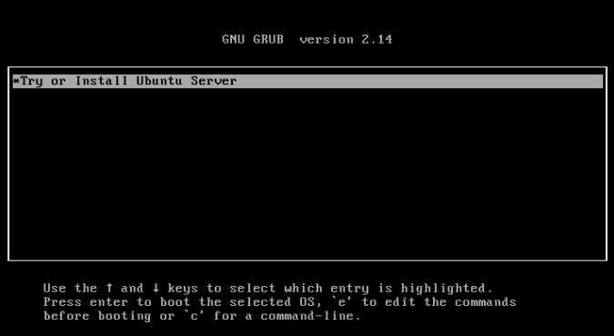

---

### 2. Wybór języka

Wybieramy **English (UK)**. Dzięki temu format daty i godziny jest zbliżony do polskiego (dzień/miesiąc/rok, zegar 24-godzinny), a system pozostaje w języku angielskim, co ułatwia szukanie rozwiązań problemów w internecie.

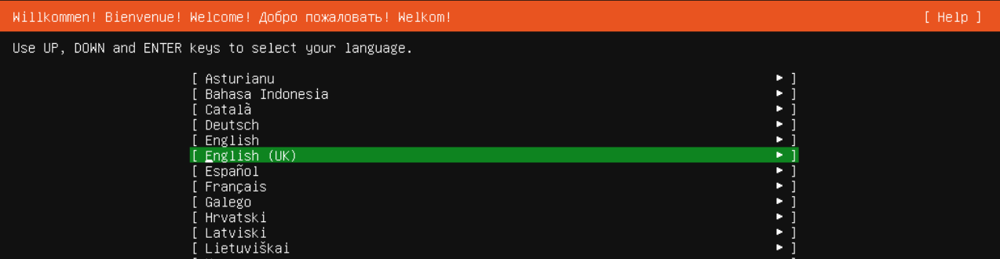

---

### 3. Układ klawiatury

- **Layout:** Polish
- **Variant:** Polish

Nie wybieramy żadnych dodatkowych opcji. Pozostawiamy standardowy polski układ klawiatury (programisty).

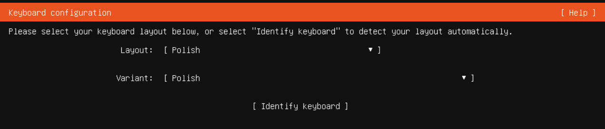

---

### 4. Typ instalacji

Wybieramy **Ubuntu Server** (zwykła wersja, **nie** *minimized*). Opcję *Search for third-party drivers* zostawiamy niezaznaczoną.

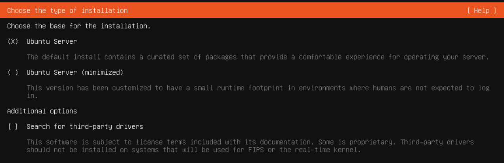

---

### 5. Konfiguracja sieci

#### Kabel Ethernet

Jeśli kabel jest podpięty, sieć powinna zostać wykryta automatycznie, a interfejs (np. `enp1s0`) otrzyma adres IP z DHCP (na zrzucie: `192.168.122.195/24`).

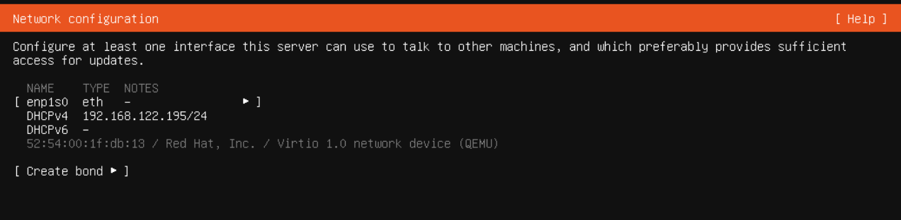

#### Wi-Fi

Jeśli komputer ma kartę Wi-Fi, można ją skonfigurować przez **Edit Wi-Fi**:

1. Wybieramy **Choose a visible network** i wskazujemy sieć (lub wpisujemy nazwę ręcznie w polu *Network Name*).
2. Wpisujemy hasło w polu *Password*.
3. Zatwierdzamy przyciskiem **Save**.
4. **Przed przejściem dalej czekamy, aż połączenie zostanie nawiązane i interfejs dostanie adres IP.**

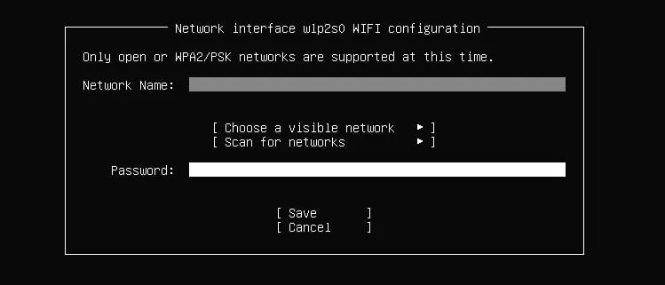

#### Adres IP

Na razie pozostawiamy **automatyczne przydzielanie adresu (DHCP)**. Niektóre routery mogą za każdym razem przydzielać inny adres, dlatego w razie potrzeby ustawienia **stałego adresu IP** można:

- ręcznie skonfigurować interfejs na ekranie sieci (*Edit IPv4* → *Manual*) albo
- później zmienić ustawienia w pliku konfiguracyjnym Netplan, np. `/etc/netplan/50-cloud-init.yaml` (nazwa pliku może się nieco różnić), a następnie zastosować zmiany poleceniem `sudo netplan apply`.

Alternatywnie można ustawić rezerwację adresu (DHCP reservation) w routerze.

---

### 6. Proxy

Pole **Proxy address** zostawiamy **puste** (nie korzystamy z proxy).

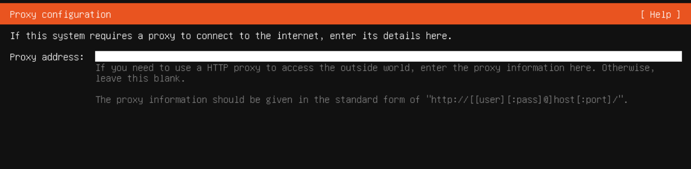

---


### 7. Mirror archiwum Ubuntu

Instalator domyślnie proponuje serwer lustrzany odpowiadający naszej lokalizacji (np. `http://pl.archive.ubuntu.com/ubuntu/`). Pozostawiamy domyślny adres i czekamy na zakończenie testu serwera (komunikat *The mirror location is being tested*), a następnie przechodzimy dalej.

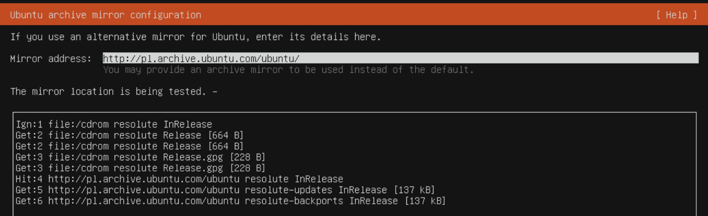

---

### 8. Konfiguracja dysku

#### Ekran 1 – wybór dysku

- Wybieramy **Use an entire disk** i wskazujemy dysk przeznaczony na system (na zrzucie `/dev/vda`, 25 GB).
- Zaznaczamy **Set up this disk as an LVM group**, jeśli chcemy korzystać z LVM, które ułatwia późniejsze zarządzanie rozmiarami woluminów. W przeciwnym razie pozostawiamy tę opcję odznaczoną. Poniżej opisano oba warianty.
- **Nie zaznaczamy** *Encrypt the LVM group with LUKS*.

> **Dlaczego bez szyfrowania?** Przy szyfrowaniu dysku hasło trzeba by wpisywać przy każdym uruchomieniu serwera. Automatyzacja tego przez SSH w initramfs jest skomplikowana, więc dla prostego serwera rezygnujemy z szyfrowania.

**Uwaga:** instalacja **nadpisuje cały wybrany dysk** – wszystkie dane na nim zostaną utracone.

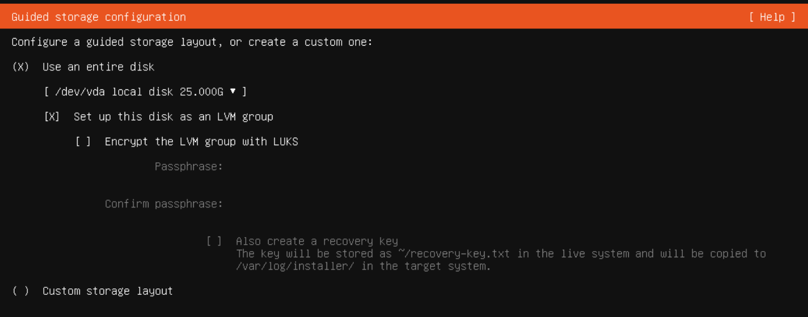

#### Ekran 2 – podsumowanie układu
#### Wariant z LVM (dla elastycznego zarządzania rozmiarami woluminów)

Instalator pokazuje proponowany podział dysku:
 
| Punkt montowania | Rozmiar | Typ | Urządzenie |
|---|---|---|---|
| `/` | ok. 11,5 GB | ext4 | LVM Logical Volume (`ubuntu-lv`) |
| `/boot` | 2 GB | ext4 | partycja dysku |
| – | 1 MB | BIOS grub spacer | partycja 1 |
 
> **Wskazówka:** domyślnie instalator przydziela woluminowi `/` tylko część przestrzeni grupy wolumenów `ubuntu-vg`. Pozostała część (na zrzucie około 11,5 GB) pozostaje jako *free space*. Można ją wykorzystać od razu, edytując `ubuntu-lv` i ustawiając jego maksymalny rozmiar, albo później, rozszerzając wolumen poleceniem:
>
> ```bash
> sudo lvextend -r -l +100%FREE /dev/ubuntu-vg/ubuntu-lv
> ```
 
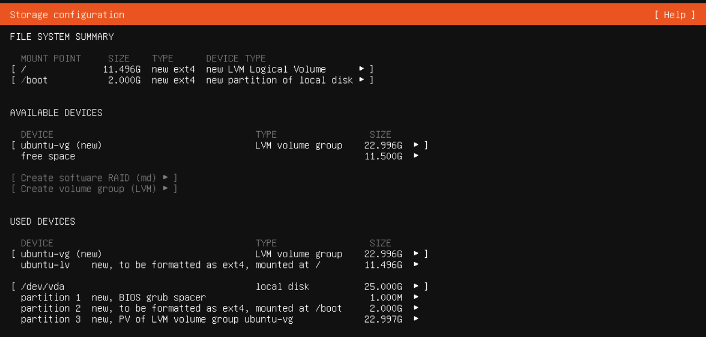
 
#### Wariant bez LVM (dla prostszego układu, którego nie planujesz później zmieniać)
 
Jeśli na pierwszym ekranie **odznaczymy** opcję *Set up this disk as an LVM group*, instalator zaproponuje prostszy układ, bez woluminów logicznych:
 
| Punkt montowania | Rozmiar | Typ | Urządzenie |
|---|---|---|---|
| `/` | ok. 25 GB (cały dysk) | ext4 | zwykła partycja dysku (partycja 2) |
| – | 1 MB | BIOS grub spacer | partycja 1 |
 
Różnice w stosunku do wariantu z LVM:
 
- cały dostępny dysk jest przeznaczony na `/` – nie zostaje wolne miejsce w grupie wolumenów (w *AVAILABLE DEVICES* widnieje *No available devices*),
- nie ma osobnej partycji `/boot` ani grupy `ubuntu-vg`,
- układ jest prostszy, ale późniejsza zmiana rozmiarów, łączenie dysków we wspólną przestrzeń i tworzenie snapshotów są mniej wygodne niż w LVM.
> **Uwaga:** na komputerach z UEFI (a nie z klasycznym BIOS-em, jak na zrzucie) instalator doda dodatkowo niewielką partycję EFI (`/boot/efi`).
 
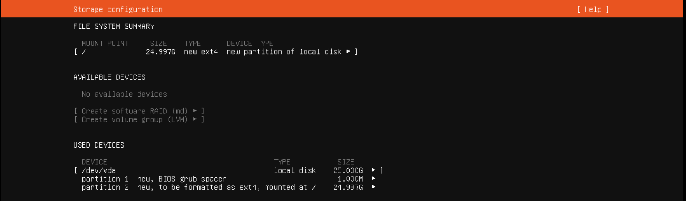

#### Nie wiesz co wybrać? 
Na początek polecam wybrać wariant z LVM i od razu przydzielić 100% wolnego miejsca do `/`. W tym celu naciskamy spację przy pozycji `ubuntu-lv`, wybieramy `Edit`, wpisujemy maksymalną wartość w polu `Size`, a następnie wybieramy `Save`.

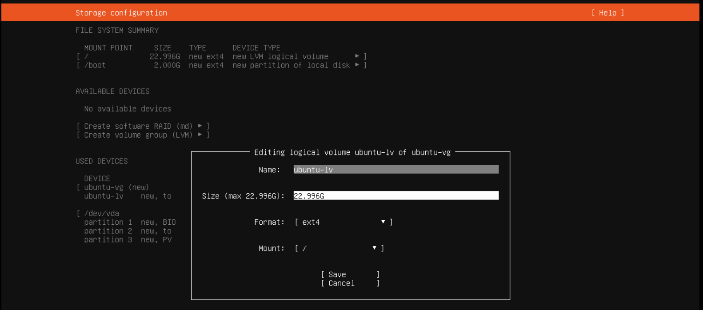


---

### 9. Profil użytkownika

Uzupełniamy dane:

| Pole | Opis | Przykład |
|---|---|---|
| **Your name** | Imię / nazwa użytkownika | `bk` |
| **Your server's name** | Nazwa serwera (hostname) widoczna w sieci | `bk-server` |
| **Pick a username** | Login użytkownika | `bk` |

Hasło jest potrzebne także do wykonywania poleceń przez `sudo`, nawet gdy później logujemy się przez SSH.

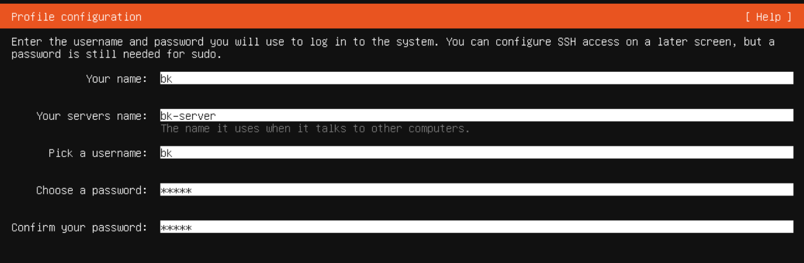

---

### 10. Ubuntu Pro

Wybieramy **Skip for now** – nie aktywujemy Ubuntu Pro. W razie potrzeby można to zrobić później poleceniem `pro attach`.

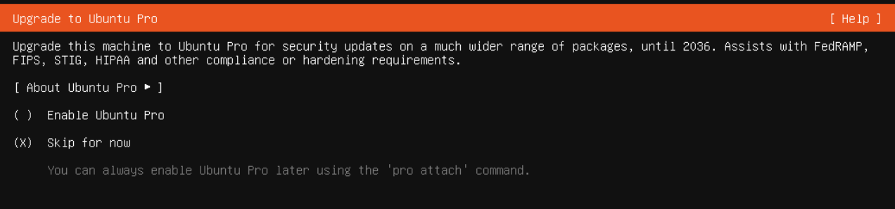

---

### 11. Konfiguracja SSH

Zaznaczamy **Install OpenSSH server**, aby można było łączyć się z serwerem zdalnie.

- *Allow password authentication over SSH* – pozostaje zaznaczone (logowanie hasłem).
- *Import SSH key* – opcjonalnie; jeśli nie importujemy klucza, zostawiamy bez zmian (*No authorized key*).

Połączenie z innego komputera:

```bash
ssh bk@<adres-ip-serwera>
```

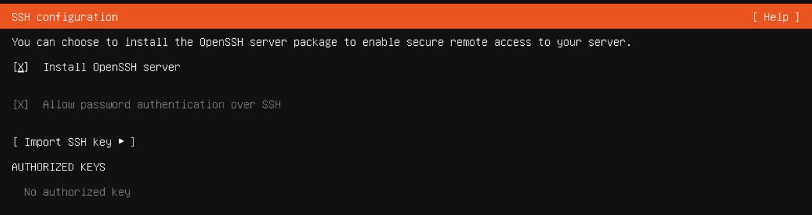

---

### 12. Dodatkowe pakiety (Featured server snaps)

Nie zaznaczamy żadnego pakietu – instalujemy tylko podstawowy system. Przechodzimy dalej przyciskiem **Done**. Wszystko, co potrzebne, można doinstalować później.

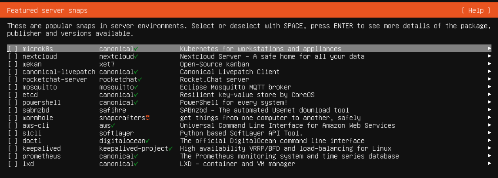

---

### 13. Zakończenie

Po zatwierdzeniu ostatniego ekranu rozpocznie się właściwa instalacja. Gdy się zakończy (pojawi się przycisk **Reboot Now**):

1. Wybieramy **Reboot Now**.
2. Po wyświetleniu komunikatu usuwamy nośnik instalacyjny i naciskamy Enter.
3. Po restarcie logujemy się utworzonym użytkownikiem.

Adres IP serwera można sprawdzić poleceniem:

```bash
ip a
```

---

### 14. Aktualizacje

Na koniec warto zaktualizować system, zanim przejdziemy do instalowania kolejnych programów.
```
sudo apt update
sudo apt upgrade -y
```
