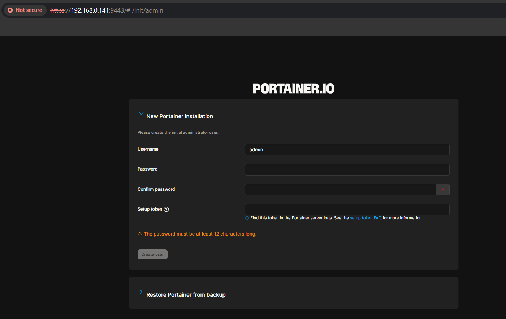
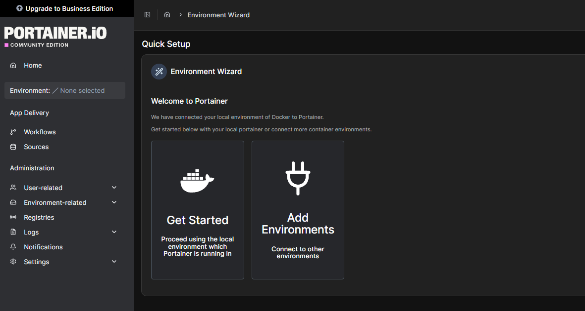
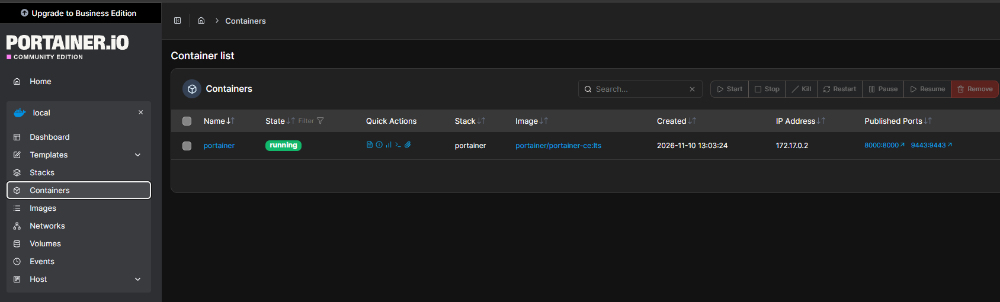

## Instalacja Portainer

### 0. Dokumentacja

Portainer to webowy interfejs do zarządzania Dockerem. Jest przydatny, gdy wolimy korzystać z interfejsu graficznego zamiast zarządzać kontenerami z poziomu terminala.
Wszystko, co opisano w tym poradniku, pochodzi z oficjalnej dokumentacji: [Instalacja Portainer CE](https://docs.portainer.io/start/install-ce/server/docker/linux#docker-compose).

### 1. Plik compose

Poniżej znajduje się zmodyfikowany plik Docker Compose, który służy do utworzenia i uruchomienia Portainera:
```
services:
  portainer:
    container_name: portainer
    image: portainer/portainer-ce:lts
    restart: unless-stopped
    volumes:
      - /var/run/docker.sock:/var/run/docker.sock
      - /home/USER/docker/portainer/data:/data
    ports:
      - 9443:9443
      - 8000:8000  # optional for Edge Agents
    network_mode: bridge
```

Wprowadzone przeze mnie zmiany:
- `restart`: używam `unless-stopped` zamiast `always`.
- `volumes`: dane są zapisywane w katalogu w moim katalogu domowym.
- `network_mode`: Portainer korzysta z domyślnej sieci.

Otwórz terminal i połącz się z serwerem:
```
ssh USER@192.168.XXX.XXX
```

Przed uruchomieniem pliku tworzymy katalog *portainer* wewnątrz katalogu *docker*, utworzonego podczas konfiguracji Dockera. Upewniamy się, że znajdujemy się w katalogu */home/USER*:
```
pwd
```
Polecenie powinno zwrócić ścieżkę */home/USER* (USER to nazwa użytkownika podana podczas instalacji Ubuntu; w moim przypadku jest to *bk*). Jeśli wynik jest inny, uruchamiamy:
```
cd
```
Następnie tworzymy potrzebne katalogi i plik:
```
cd docker
mkdir portainer
mkdir portainer/data
cd portainer
touch docker-compose.yml
```
Wklejamy zawartość pliku Compose do *docker-compose.yml*. Kopiujemy powyższy kod, a następnie uruchamiamy:
```
nano docker-compose.yml
Ctrl+Shift+V -> wklej tekst
Zmień USER na swoją nazwę użytkownika, np. bk
Ctrl+O -> zapisz plik
Enter -> potwierdź zapis
Ctrl+X -> zamknij plik
```
---
### 2. Utworzenie kontenera

Teraz uruchamiamy polecenie, będąc w katalogu */home/USER/docker/portainer*:
```
sudo docker compose up -d
```
Po chwili kontener powinien się uruchomić.

### 3. Konfiguracja wstępna

Pod koniec instalacji Ubuntu sprawdzaliśmy adres IP serwera. Użyjemy go teraz do konfiguracji Portainera. Otwieramy przeglądarkę i wpisujemy adres:
```
https://IP:9443
```
Może być konieczne zaakceptowanie ostrzeżenia o braku certyfikatu HTTPS. Ponieważ łączymy się z własnym serwerem, akceptujemy je. Powinien wyświetlić się następujący ekran:



Wpisujemy nazwę administratora i dwukrotnie podajemy hasło. Następnie wracamy do terminala i uruchamiamy:
```
sudo docker logs portainer
```
Kopiujemy wartość pola *setup_token=345kjh345hk;j3245kjh23k5jhk...*.

Zamiast formularza tworzenia konta użytkownika może pojawić się komunikat o błędzie z sugestią ponownego uruchomienia kontenera. W takim przypadku wracamy w terminalu do katalogu */home/USER/docker/portainer* i uruchamiamy:
```
sudo docker compose down
sudo docker compose up -d
sudo docker logs portainer
```

Od razu kopiujemy *setup_token*, odświeżamy stronę w przeglądarce i uzupełniamy wszystkie pola. Pomijamy etap konfiguracji Edge Agents. Powinien wyświetlić się następujący ekran:



Klikamy *Home* po lewej stronie, a następnie wybieramy *local*. Otworzy się widok lokalnego środowiska, w którym możemy przeglądać kontenery.


