## Instalacja Nginx Proxy Manager

### 1. Plik compose

Poniżej znajduje się plik Docker Compose służący do utworzenia i uruchomienia Nginx Proxy Managera:
```
services:
  nginx-pm:
    image: jc21/nginx-proxy-manager:latest
    container_name: nginx-pm
    restart: unless-stopped
    network_mode: bridge

    ports:
      - "80:80"
      - "81:81"
      - "443:443"

    environment:
      TZ: Europe/Warsaw

    volumes:
      - /home/USER/docker/nginx-pm/data:/data
      - /home/USER/docker/nginx-pm/letsencrypt:/etc/letsencrypt
```

Otwórz terminal i połącz się z serwerem:
```
ssh USER@192.168.XXX.XXX
```

Przed uruchomieniem pliku tworzymy katalog *nginx-pm* wewnątrz katalogu *docker*, utworzonego podczas konfiguracji Dockera. Upewniamy się, że znajdujemy się w katalogu */home/USER*:
```
cd docker
mkdir nginx-pm
mkdir nginx-pm/data
mkdir nginx-pm/letsencrypt
cd nginx-pm
touch docker-compose.yml
```
Wklejamy zawartość pliku Compose do *docker-compose.yml*. Kopiujemy powyższy kod, a następnie uruchamiamy:
```
nano docker-compose.yml
Ctrl+Shift+V -> wklej tekst
Zmień USER na swoją nazwę użytkownika, np. bk
Ctrl+O -> zapisz plik
Enter -> potwierdź zapis
Ctrl+X -> zamknij plik
```
---


### 2. Utworzenie kontenera

Teraz uruchamiamy polecenie, będąc w katalogu */home/USER/docker/nginx-pm*:
```
sudo docker compose up -d
```
---

### 3. Konfiguracja

Otwieramy przeglądarkę i wpisujemy adres serwera z portem 81. Powinien wyświetlić się ekran tworzenia konta administratora:

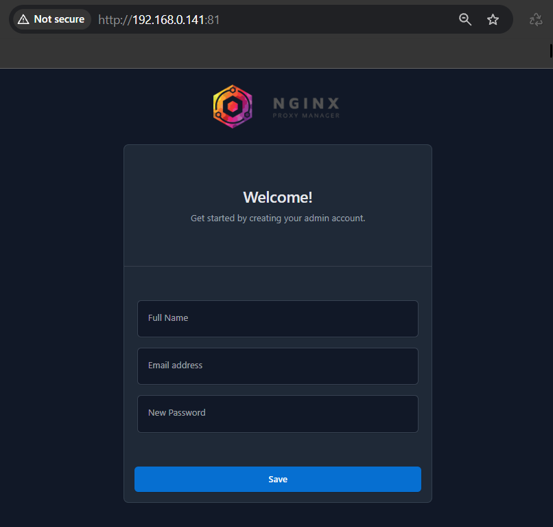


Po utworzeniu konta administratora zobaczymy następujący ekran:

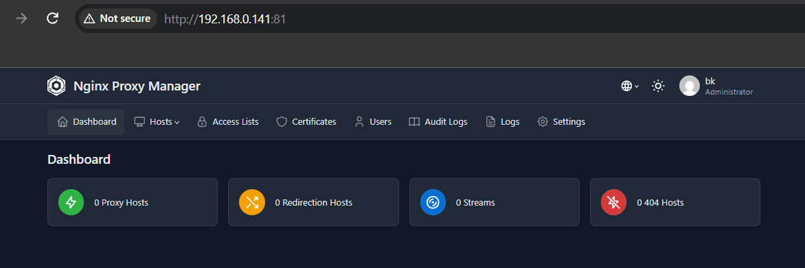


Klikamy *Certificates*. Zobaczymy tam przycisk umożliwiający utworzenie nowego certyfikatu. Wrócimy do tego później.

#### Serwis DNS

Do utworzenia certyfikatu potrzebujemy domeny i usługi DNS. Jedną z wielu darmowych opcji jest Dynu ([strona Dynu](https://www.dynu.com/)).
Zakładamy konto i logujemy się. Następnie na ekranie startowym klikamy ikonę koła zębatego w prawym górnym rogu. Powinien wyświetlić się ten ekran:

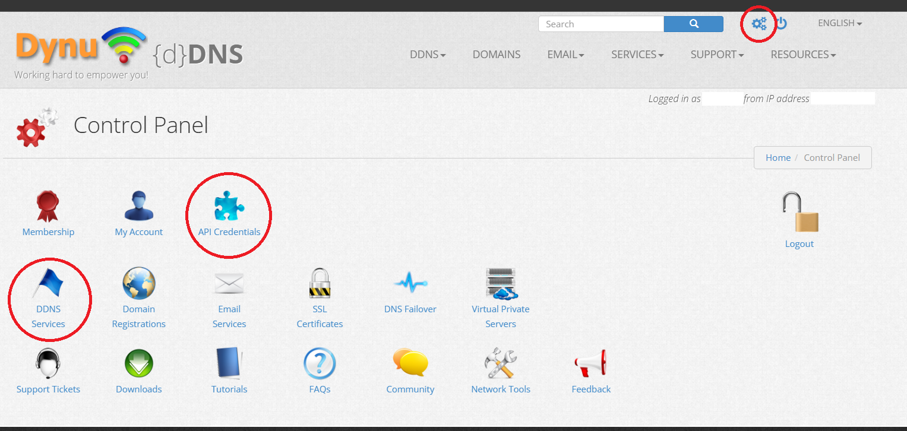


Otwieramy *DDNS Services* i klikamy *+Add* po prawej stronie. Następnie wybieramy dostępną nazwę domeny i jej rozszerzenie:

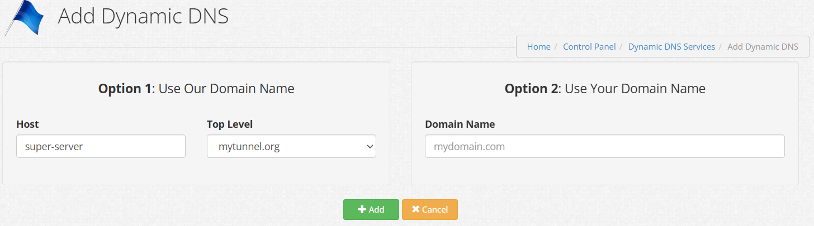

Klikamy *+Add*. W kolejnym kroku wpisujemy lokalny adres IP serwera w polu *IP*, a następnie klikamy *Save*:

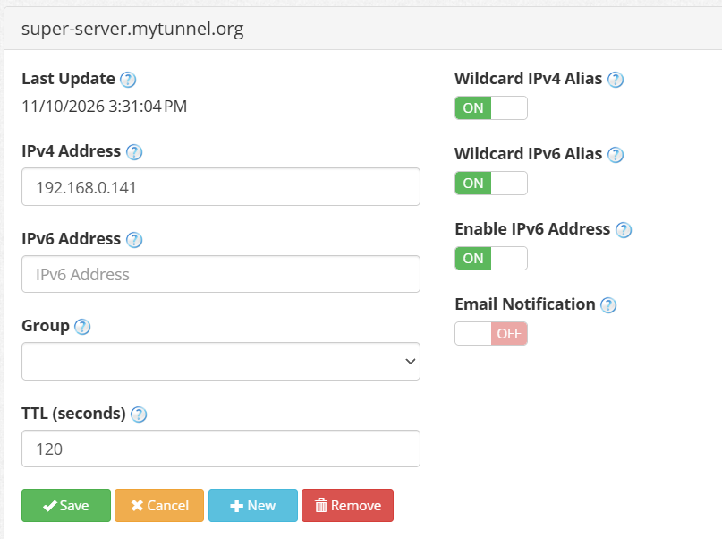

Po powrocie do ekranu *DDNS Services* powinniśmy zobaczyć utworzony adres:

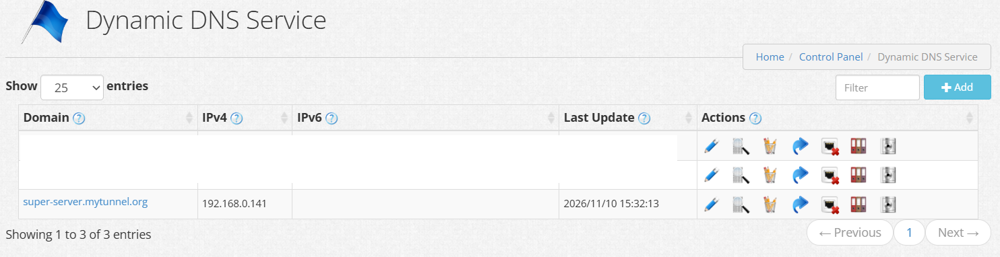

Wracamy do ekranu usług, klikamy ikonę koła zębatego w rogu strony i wybieramy *API Credentials*. Jeśli nie mamy jeszcze klucza API, generujemy go przyciskiem *Generate API Credentials*. Następnie wyświetlamy wartość *API Key* i kopiujemy ją.

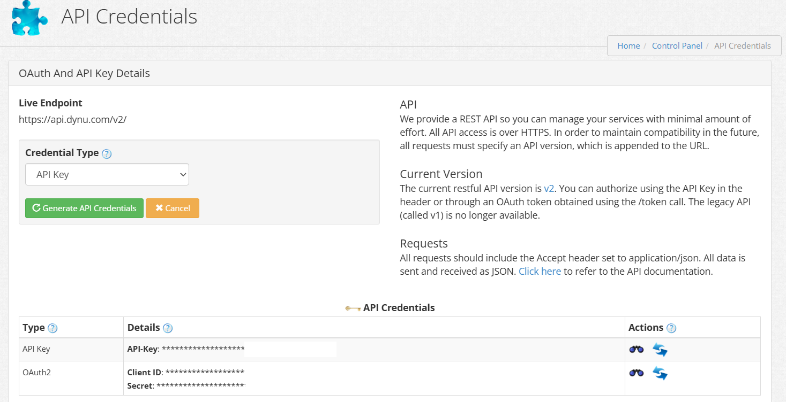

#### Utworzenie certyfikatu

Wracamy do strony certyfikatów w Nginx Proxy Managerze, klikamy *Add certificate* i wybieramy opcję *Let's Encrypt via DNS*:

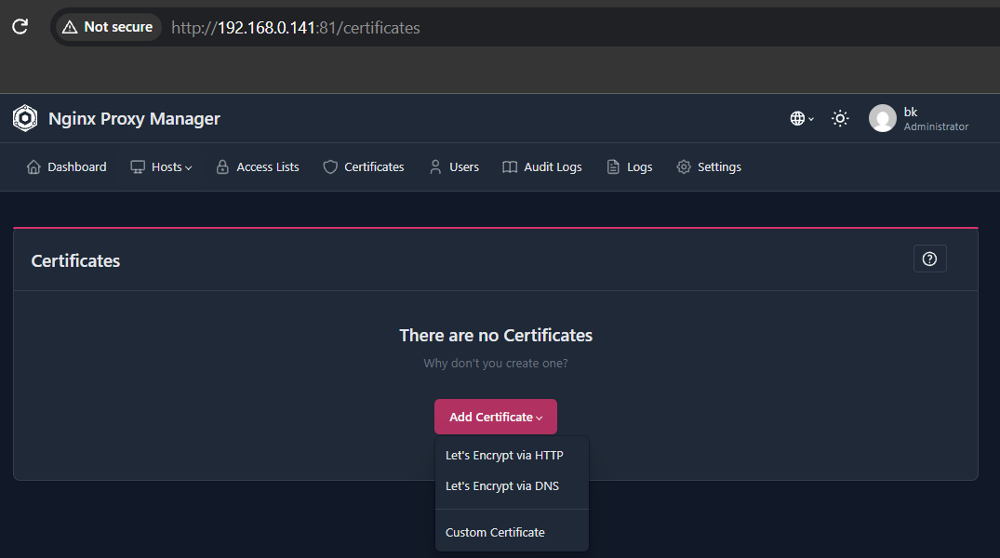

Wpisujemy adres domeny, wybieramy dostawcę Dynu i wklejamy wcześniej skopiowany klucz API. Następnie klikamy *Save* i czekamy na wynik. Może to potrwać ponad minutę:

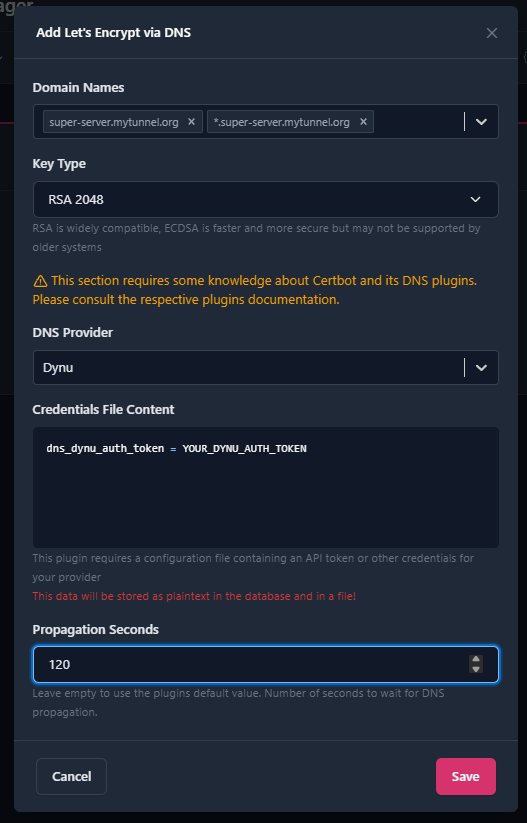

Po zakończeniu operacji powinniśmy zobaczyć nowy certyfikat:

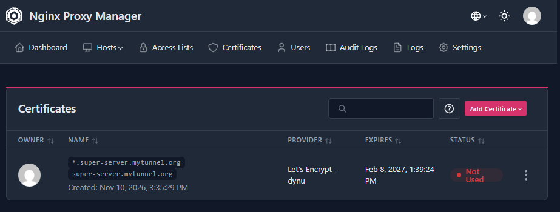

W razie problemów zajrzyj do sekcji na końcu tego dokumentu.

#### Tworzenie proxy host

Po uzyskaniu certyfikatu możemy skonfigurować przekierowanie z domeny na adres IP serwera i odpowiedni port. W Nginx Proxy Managerze przechodzimy do *Dashboard*, a następnie do *Proxy Hosts*. Klikamy *Add proxy host* i wypełniamy pola jak na zrzucie:

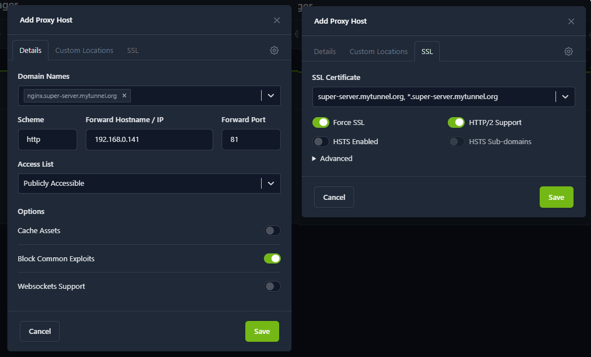

Teraz możemy sprawdzić działanie proxy. Poniżej widoczna jest strona otwarta bezpośrednio przez adres IP (zwróć uwagę na komunikat *Not secure*):

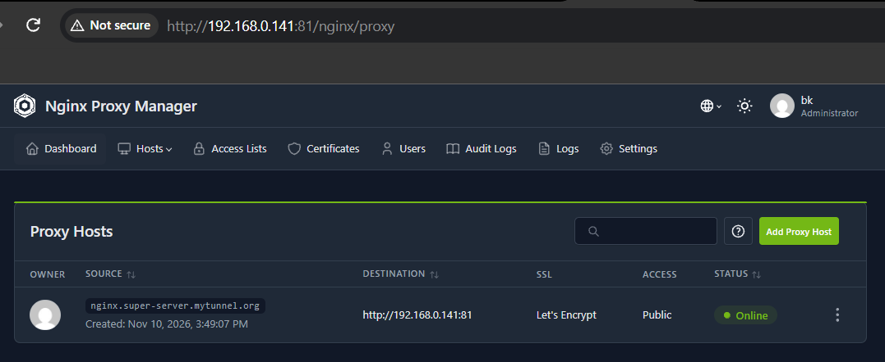

Po wpisaniu nowo utworzonego adresu proxy strona wygląda następująco: połączenie jest bezpieczne, a adres IP nie jest widoczny w pasku adresu.

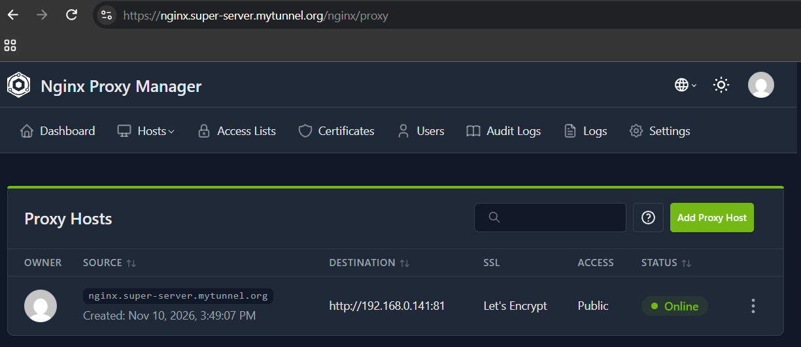

Teraz możemy skonfigurować proxy dla Portainera:

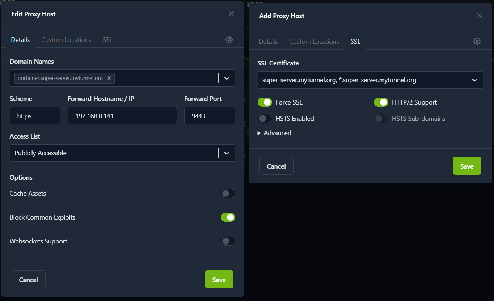
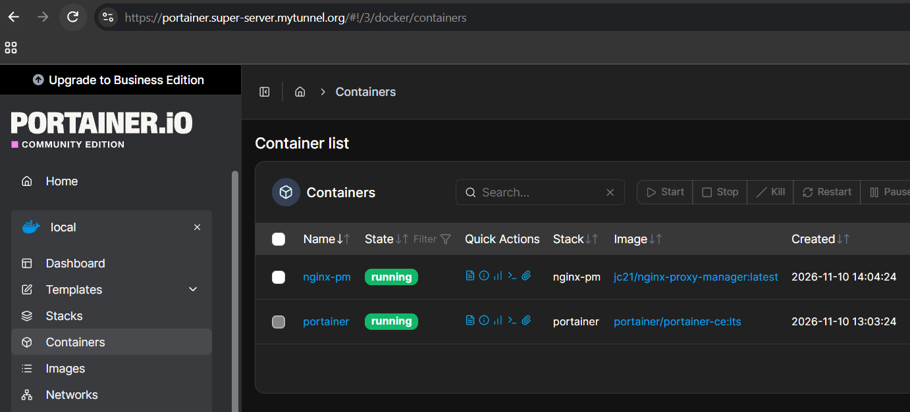

---

### 4. Uwagi

#### Dostępność domen w internecie

Te przekierowania proxy działają wyłącznie w sieci lokalnej, więc domeny nie są dostępne z zewnątrz. Osoba, która wpisze taki adres na komputerze podłączonym do innej sieci, zostanie skierowana na adres `192.168.0.141` w swojej sieci i najprawdopodobniej zobaczy błąd informujący, że strona nie istnieje. W tej konfiguracji nie udostępniamy usług poza siecią lokalną ani w internecie.

#### Konfiguracja proxy dla kontenerów

Dla każdego nowego kontenera z interfejsem webowym możemy skonfigurować proxy hosta. Dzięki temu jego interfejs otworzymy pod adresem domenowym, np. *moj-kontener.super-server.mytunnel.org*.

#### Problemy

Podczas generowania certyfikatu mogą wystąpić następujące problemy:
- **Brak certyfikatu:** upewnij się, że w polu z kluczem `dns_dynu_auth_token=YOUR_DYNU_AUTH_TOKEN` nie ma zbędnych spacji, szczególnie wokół znaku `=`.
- **Internal Server Error:** prawdopodobnie osiągnięto limit żądań certyfikatu dla wybranego rozszerzenia domeny (np. `mytunnel.org`). Spróbuj wybrać inną domenę.
- **Timeout:** upłynął limit czasu oczekiwania na odpowiedź albo wystąpił błąd. Spróbuj ponownie i ustaw w ostatnim polu wartość większą niż 120.
- **Niekończące się ładowanie:** sprawdź, czy certyfikat nie pojawił się już w tle okna. Czasami okno zawiesza się i nie znika, mimo że operacja zakończyła się powodzeniem.


