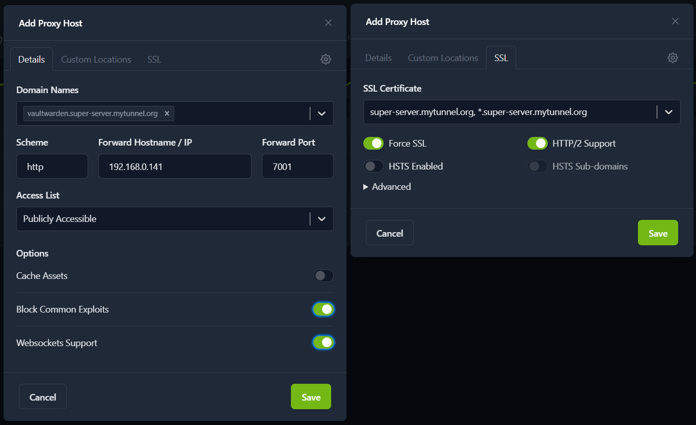
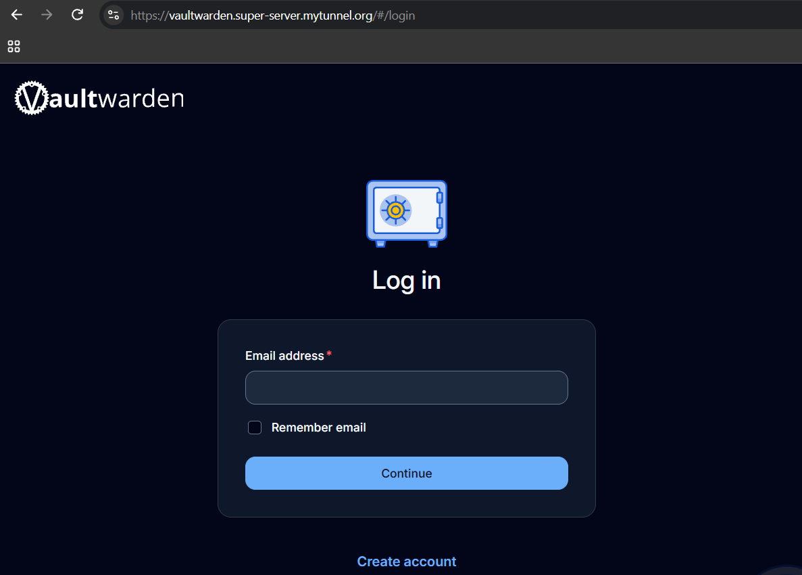
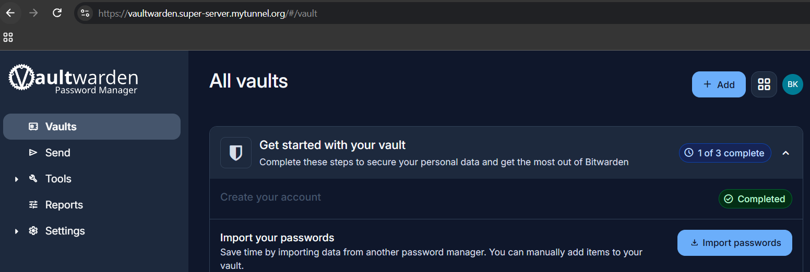
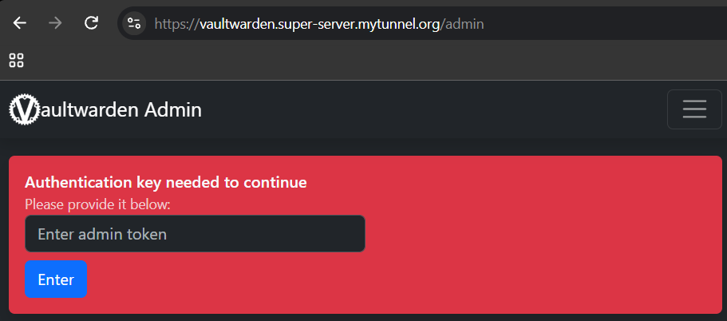
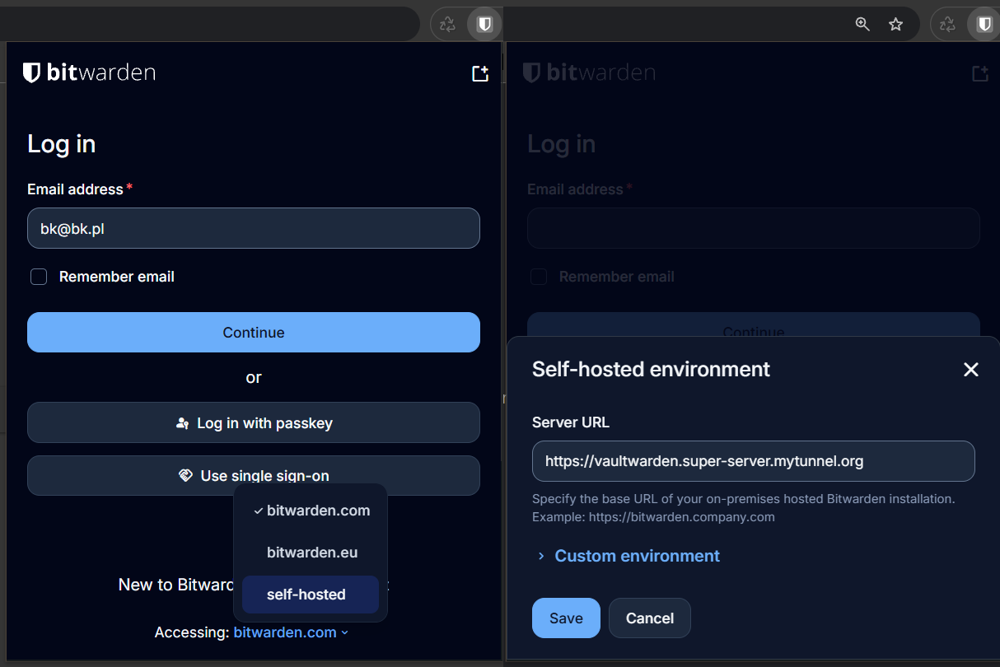

## Instalacja Vaultwarden

### 0. Dokumentacja

Vaultwarden to nieoficjalny serwer kompatybilny z Bitwarden, który umożliwia samodzielne hostowanie menedżera haseł. Implementacja zawiera niezbędne funkcje bez zawartości premium. Oficjalna dokumentacja: [Vaultwarden GitHub](https://github.com/dani-garcia/vaultwarden).

---

### 1. Plik compose

Poniżej znajduje się plik Docker Compose służący do utworzenia i uruchomienia Vaultwarden:
```
services:
  vaultwarden:
    image: vaultwarden/server:latest
    container_name: vaultwarden
    restart: unless-stopped
    network_mode: bridge

    ports:
      - "7001:80"

    environment:
      SIGNUPS_ALLOWED: "true" # later change to false and restart container
      ADMIN_TOKEN: ${ADMIN_TOKEN}

    volumes:
      - /home/USER/docker/vaultwarden/data:/data
```

Otwórz terminal i połącz się z serwerem:
```
ssh USER@192.168.XXX.XXX
```

Przed uruchomieniem pliku tworzymy katalog *vaultwarden* wewnątrz katalogu *docker*, utworzonego podczas konfiguracji Dockera. Upewniamy się, że znajdujemy się w katalogu */home/USER*:
```
pwd
```
Polecenie powinno zwrócić ścieżkę */home/USER* (USER to nazwa użytkownika podana podczas instalacji Ubuntu; w moim przypadku jest to *bk*). Jeśli wynik jest inny, uruchamiamy:
```
cd
```
Następnie tworzymy potrzebne katalogi i plik:
```
cd docker
mkdir vaultwarden
mkdir vaultwarden/data
cd vaultwarden
touch docker-compose.yml
```
Wklejamy zawartość pliku Compose do *docker-compose.yml*. Kopiujemy powyższy kod, a następnie uruchamiamy:
```
nano docker-compose.yml
Ctrl+Shift+V -> wklej tekst
Zmień USER na swoją nazwę użytkownika, np. bk
Ctrl+O -> zapisz plik
Enter -> potwierdź zapis
Ctrl+X -> zamknij plik
```

---

### 2. Konfiguracja zmiennych środowiskowych

W pierwszej kolejności wygenerujemy hash hasła administratora. W tym celu musimy zainstalować pakiet *argon2*:
```
sudo apt install argon2
```
Następnie wygenerujemy hash hasła do odblokowywania panelu administratora w Vaultwarden. Wprowadź swoje hasło w odpowiednim miejscu:
```
echo -n 'YOUR_SECRET_PASSWORD' | argon2 "$(openssl rand -base64 32)" -e -id -k 65540 -t 3 -p 4
```
Następnie skopiuj wynik powyższego polecenia. Umieścimy go w pliku `.env`, który utworzymy w katalogu */home/USER/docker/vaultwarden*:
```
cd /home/USER/docker/vaultwarden
touch .env
nano .env
```
Zawartość pliku powinna wyglądać podobnie do poniższego przykładu:
```
ADMIN_TOKEN='$argon2id$v=19$m=65540,t=3,p=4$TTZ3cVJvN01EdysyS0JndTFaMExtTzBlSkNtZ0x2SUFqeEhscUxFbWg3ST0$Q4MDtcVOJifAIG0QZuYy1d3ipnhFGMjXz39odsKPXDc'
```
Zapisz plik:
```
Ctrl+O -> Enter -> Ctrl+X 
```

---

### 3. Utworzenie kontenera

Teraz uruchamiamy polecenie, będąc w katalogu */home/USER/docker/vaultwarden*:
```
sudo docker compose up -d
```

### 4. Utworzenie proxy hosta w Nginx

Zakładając, że mamy już skonfigurowany Nginx Proxy Manager, przechodzimy w przeglądarce pod jego adres, np. *nginx.super-server.mytunnel.org*. Logujemy się na utworzone konto i dodajemy nowy proxy host, jak pokazano poniżej:



Teraz możemy przejść do strony *vaultwarden.super-server.mytunnel.org* i powinniśmy zobaczyć następujący ekran:



---

### 5. Utworzenie konta i panel administratora

Na ekranie logowania klikamy *Create account* i postępujemy zgodnie z instrukcjami kreatora konta, uzupełniając adres e-mail i hasło główne. Efektem końcowym powinna być poniższa strona:



Polecam zapoznać się z tą stroną, ale głównie będziemy korzystać z wtyczki Bitwarden.

#### Panel administratora

Panel administracyjny dostępny jest pod adresem *vaultwarden.super-server.mytunnel.org/admin* i powinien wyglądać następująco:



Aby się zalogować, musimy użyć hasła, którego hash wygenerowaliśmy w kroku 2 za pomocą pakietu argon2. Jeśli wszystko zostało wykonane poprawnie, logowanie powinno się powieść. Panel administratora służy do konfiguracji zaawansowanych ustawień serwera, ale na potrzeby indywidualnego użytkownika raczej nie będziemy z niego korzystać.

---

### 6. Wyłączenie rejestracji

Jeśli chcemy wyłączyć możliwość tworzenia nowych kont, wracamy do terminala i wykonujemy następujące czynności:
```
cd /home/USER/docker/vaultwarden
nano docker-compose.yml
-- zmieniamy SIGNUPS_ALLOWED: "true" -> "false" 
-- zapisujemy i zamykamy plik: Ctrl+O -> Enter -> Ctrl+X
sudo docker compose down
sudo docker compose up -d
```

---

### 7. Połączenie z wtyczką Bitwarden

Aby skorzystać z naszego serwera Vaultwarden, musimy dodać rozszerzenie Bitwarden do przeglądarki. Nie będę opisywał tego kroku, ponieważ wystarczy znaleźć oficjalną wtyczkę od bitwarden.com dla używanej przeglądarki.

Gdy mamy już ją zainstalowaną, możemy połączyć ją z naszym serwerem, wybierając na dole opcję *self-hosted* i wpisując adres serwera. Później logujemy się na utworzone konto, używając hasła głównego (nie mylić z hasłem administratora), i gotowe.



Od teraz przy wpisywaniu haseł w przeglądarce powinny pojawiać się pytania, czy chcemy zapisać hasło w menedżerze. Wyświetlane będą również sugestie autouzupełniania wcześniej zapisanych haseł.