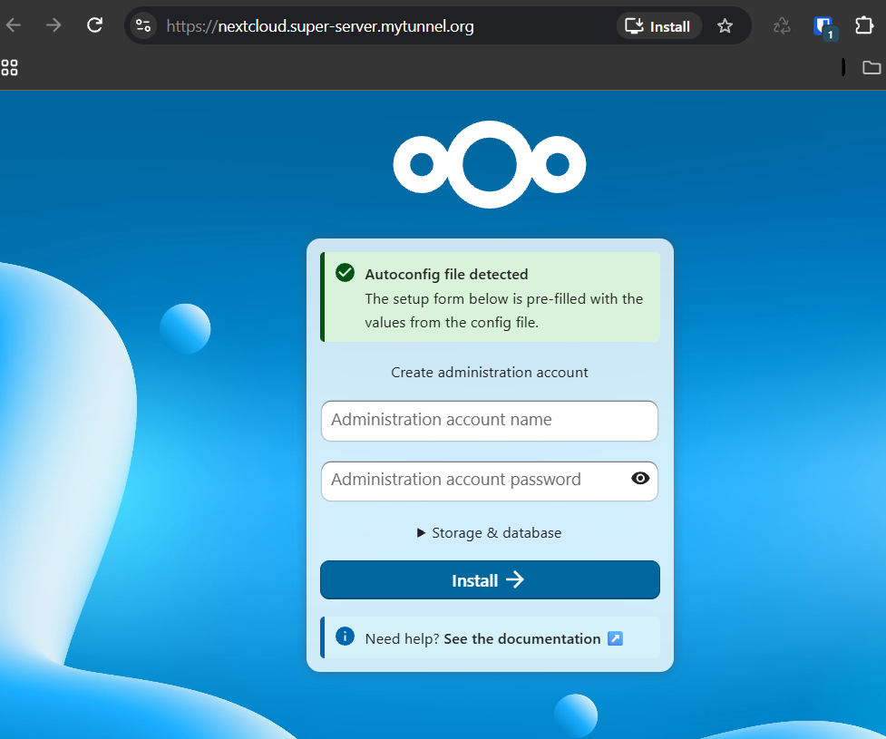
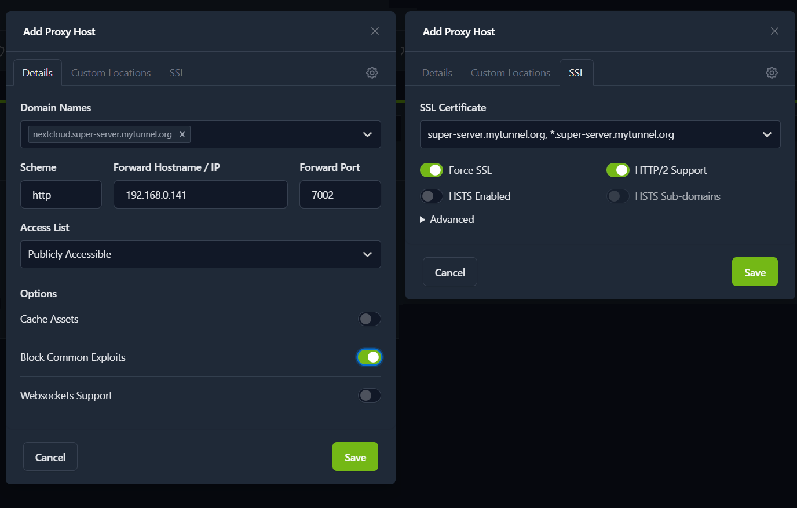
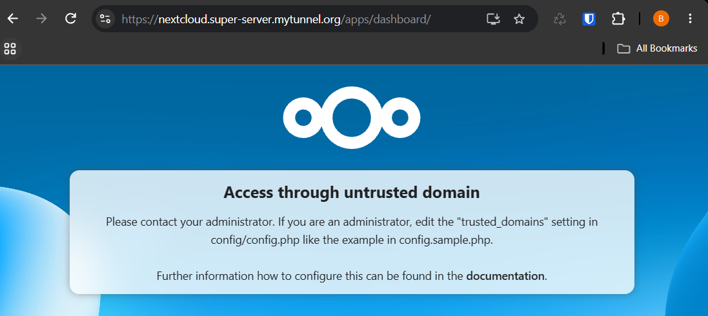
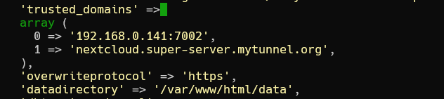

## Instalacja Nextcloud

### 0. Dokumentacja

Nextcloud to platforma do samodzielnego przechowywania i synchronizacji plików oraz współpracy. Zobacz [oficjalną dokumentację Nextcloud](https://docs.nextcloud.com/) oraz [oficjalny obraz Nextcloud w Docker Hub](https://hub.docker.com/_/nextcloud).

---

### 1. Plik compose

Poniższy plik Docker Compose tworzy kontenery Nextcloud, MariaDB i Redis:

```
services:
  db:
    image: mariadb:lts
    container_name: nextcloud-db
    restart: unless-stopped
    command: --transaction-isolation=READ-COMMITTED --log-bin=binlog --binlog-format=ROW
    volumes:
      - /home/USER/docker/nextcloud/db:/var/lib/mysql
    environment:
      MYSQL_ROOT_PASSWORD: USER_DB_ROOT_PASSWORD
      MYSQL_DATABASE: nextcloud
      MYSQL_USER: nextcloud
      MYSQL_PASSWORD: DB_PASSWORD
    networks:
      - nextcloud

  redis:
    image: redis:latest
    container_name: nextcloud-redis
    restart: unless-stopped
    command: redis-server --save 60 1 --loglevel warning
    volumes:
      - /home/USER/docker/nextcloud/redis:/data
    networks:
      - nextcloud

  app:
    image: nextcloud:stable
    container_name: nextcloud-app
    restart: unless-stopped
    depends_on:
      - db
      - redis
    ports:
      - "7002:80"
    volumes:
      - /home/USER/docker/nextcloud/html:/var/www/html
    environment:
      MYSQL_HOST: db
      MYSQL_DATABASE: nextcloud
      MYSQL_USER: nextcloud
      MYSQL_PASSWORD: DB_PASSWORD
      REDIS_HOST: redis
      NEXTCLOUD_ADMIN_USER: USER
      NEXTCLOUD_ADMIN_PASSWORD: PASSWORD
      NEXTCLOUD_TRUSTED_DOMAINS: 192.168.XXX.XXX # server local ip
    networks:
      - nextcloud

networks:
  nextcloud:
    driver: bridge
```

Przed uruchomieniem pliku zmień wszystkie wartości zastępcze `USER`, `PASSWORD`, `DB_PASSWORD` i `USER_DB_ROOT_PASSWORD` na własne dane. Zmień również `192.168.XXX.XXX` na lokalny adres IP serwera.

Otwórz terminal i połącz się z serwerem:
```
ssh USER@192.168.XXX.XXX
```

Upewnij się, że znajdujesz się w katalogu `/home/USER`:
```
pwd
```
Jeśli wynik jest inny, przejdź do katalogu domowego:
```
cd
```
Następnie utwórz potrzebne katalogi i plik Compose:
```
cd docker
mkdir nextcloud
mkdir nextcloud/db
mkdir nextcloud/redis
mkdir nextcloud/html
cd nextcloud
touch docker-compose.yml
```

Wklej powyższą zawartość do pliku `docker-compose.yml`:
```
nano docker-compose.yml
Ctrl+Shift+V -> wklej tekst
Zmień wartości zastępcze USER, PASSWORD oraz adres IP na własne
Ctrl+O -> zapisz plik
Enter -> potwierdź zapis
Ctrl+X -> zamknij plik
```
---
### 2. Utworzenie kontenerów

Uruchom poniższe polecenie z katalogu `/home/USER/docker/nextcloud`:
```
sudo docker compose up -d
```
---

### 3. Instalacja webowa Nextcloud

Otwórz w przeglądarce adres `http://192.168.XXX.XXX:7002`. Powinien pojawić się ekran instalacji Nextcloud:



Dane połączenia z bazą MariaDB powinny zostać uzupełnione automatycznie. Możesz je sprawdzić, rozwijając sekcję *Storage & database*. Wpisz nazwę i hasło konta administratora Nextcloud, a następnie kliknij *Install*. Instalacja może potrwać kilka minut. Po jej zakończeniu pojawią się dodatkowe ekrany konfiguracji i samouczek, a następnie pulpit (*Dashboard*).

---

### 4. Konfiguracja hosta proxy w Nginx Proxy Manager i pliku config.php

Jeśli Nginx Proxy Manager jest już skonfigurowany, otwórz jego adres, np. `nginx.super-server.mytunnel.org`, i zaloguj się. Następnie dodaj nowy proxy host, jak pokazano poniżej:



Otwórz domenę Nextcloud, np. `nextcloud.super-server.mytunnel.org`. Jeśli zobaczysz komunikat o niezaufanej domenie, dodaj ją do listy zaufanych domen w konfiguracji Nextcloud:



W terminalu przejdź do katalogu `/home/USER/docker/nextcloud` i otwórz plik konfiguracyjny:
```
cd /home/USER/docker/nextcloud
sudo nano html/config/config.php
```

W sekcji `trusted_domains` dodaj domenę Nextcloud jako kolejny element tablicy. Bezpośrednio za tą sekcją dodaj również wpis:
```
'overwriteprotocol' => 'https',
```
Wpis ten wymusza korzystanie z protokołu HTTPS i może rozwiązać problemy z logowaniem za pośrednictwem proxy. Po zmianach odpowiednie fragmenty pliku powinny wyglądać następująco:



Po zapisaniu zmian odśwież stronę Nextcloud. Powinna wyświetlić się poprawnie.