## Ubuntu Server Installation – Basic Version

### 0. Navigation

Navigation in the installer is performed using the following keys: arrow keys ↑ ↓ are used for movement, **Enter** – to confirm, **Space** – to select options, and **Tab** – to move between fields. At the end of each screen, we select **Done** (or **Continue**) to proceed.


### 1. GRUB Boot Menu

After starting the computer from the installation media (USB drive or ISO image), the GRUB menu appears. We select the default option **Try or Install Ubuntu Server** and confirm with Enter.

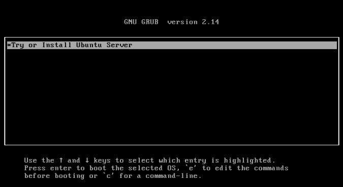

---

### 2. Language Selection

We select **English (UK)**. This way, the date and time format is similar to Polish standards (day/month/year, 24-hour clock), and the system remains in English, which makes it easier to find solutions to problems on the internet.

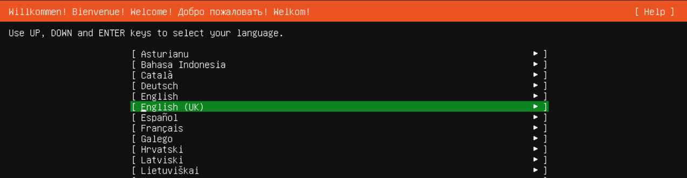

---

### 3. Keyboard Layout

- **Layout:** Polish
- **Variant:** Polish

We do not select any additional options. We keep the standard Polish keyboard layout (programmer).

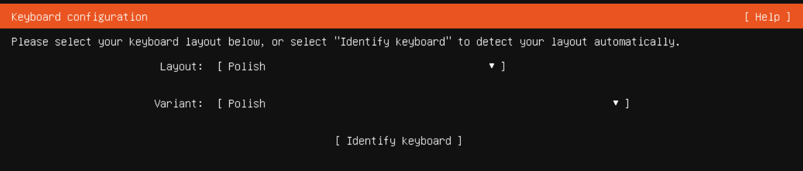

---

### 4. Installation Type

We select **Ubuntu Server** (the regular version, **not** *minimized*). The option *Search for third-party drivers* we leave unchecked.

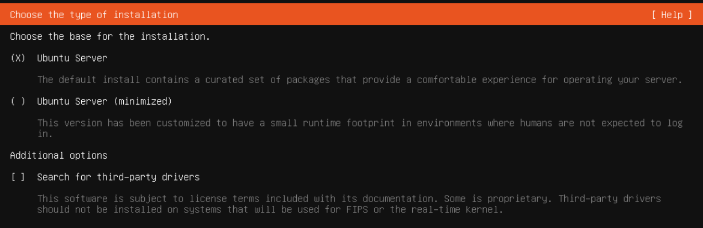

---

### 5. Network Configuration

#### Ethernet Cable

If a cable is connected, the network should be detected automatically, and the interface (e.g., `enp1s0`) will receive an IP address from DHCP (in the screenshot: `192.168.122.195/24`).

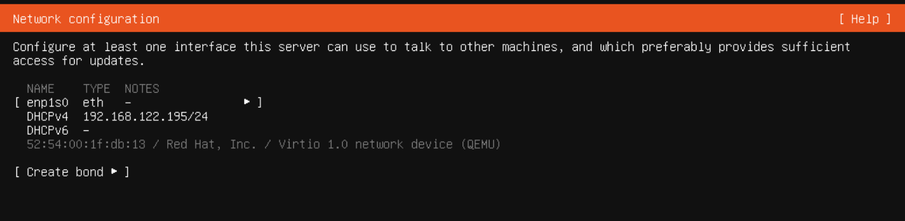

#### Wi-Fi

If the computer has a Wi-Fi card, it can be configured via **Edit Wi-Fi**:

1. We select **Choose a visible network** and point to the network (or manually enter the name in the *Network Name* field).
2. We enter the password in the *Password* field.
3. We confirm by clicking the **Save** button.
4. **Before proceeding, we wait for the connection to be established and the interface to receive an IP address.**

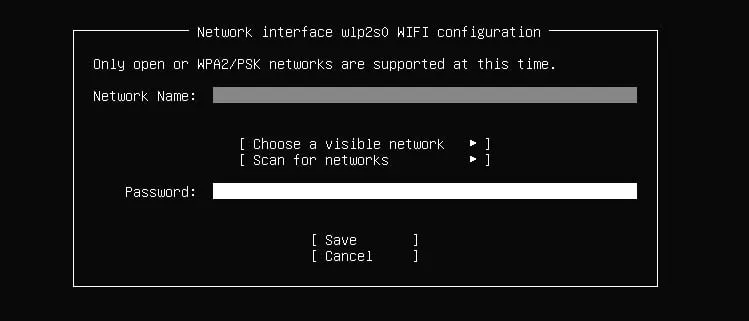

#### IP Address

For now, we keep the **automatic IP address assignment (DHCP)**. Some routers may assign a different address each time, so if you need to set a **static IP address**, you can:

- manually configure the interface on the network screen (*Edit IPv4* → *Manual*) or
- later change the settings in the Netplan configuration file, e.g., `/etc/netplan/50-cloud-init.yaml` (the filename may vary slightly), and then apply the changes with the `sudo netplan apply` command.

Alternatively, you can set up an address reservation (DHCP reservation) in the router.

---

### 6. Proxy

The **Proxy address** field we leave **empty** (we do not use a proxy).

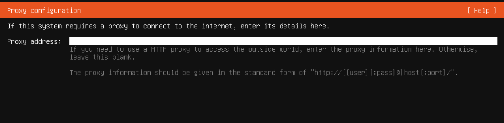

---


### 7. Ubuntu Archive Mirror

The installer by default suggests a mirror server corresponding to our location (e.g., `http://pl.archive.ubuntu.com/ubuntu/`). We keep the default address and wait for the server test to complete (the message *The mirror location is being tested*), and then proceed.

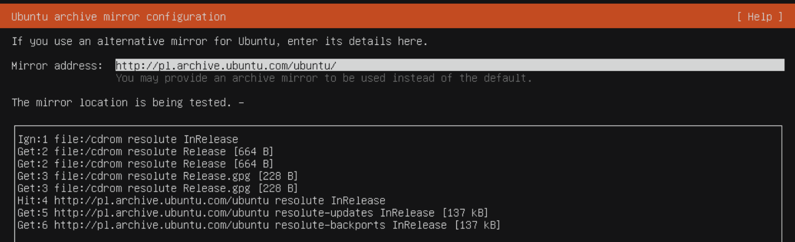

---

### 8. Disk Configuration

#### Screen 1 – Disk Selection

- We select **Use an entire disk** and point to the disk intended for the system (in the screenshot `/dev/vda`, 25 GB).
- We check **Set up this disk as an LVM group** if we want to use LVM, which makes it easier to manage volume sizes later. Otherwise, we leave this option unchecked. Both variants are described below.
- We do **not check** *Encrypt the LVM group with LUKS*.

> **Why without encryption?** With disk encryption, we would have to enter a password on every server restart. Automating this via SSH in initramfs is complicated, so for a simple server we skip encryption.

**Warning:** installation **overwrites the entire selected disk** – all data on it will be lost.

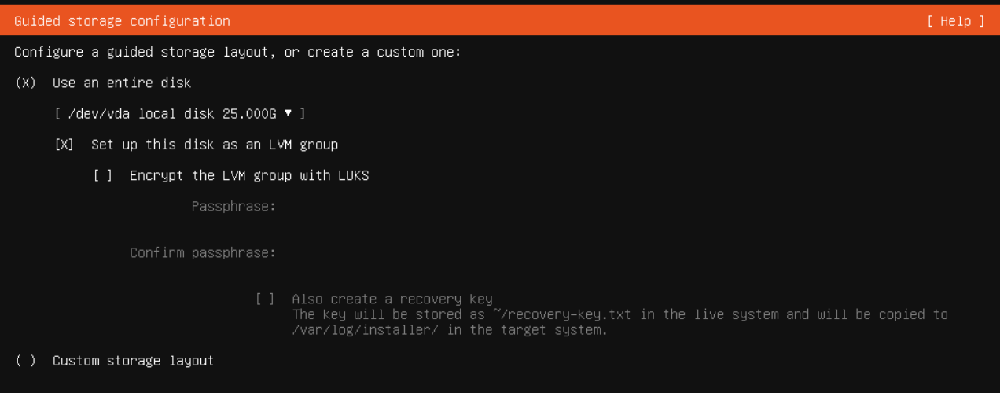

#### Screen 2 – Layout Summary
#### Variant with LVM (for flexible volume size management)

The installer shows the proposed disk layout:
 
| Mount Point | Size | Type | Device |
|---|---|---|---|
| `/` | approx. 11.5 GB | ext4 | LVM Logical Volume (`ubuntu-lv`) |
| `/boot` | 2 GB | ext4 | disk partition |
| – | 1 MB | BIOS grub spacer | partition 1 |
 
> **Tip:** by default, the installer allocates to the `/` volume only part of the volume group space `ubuntu-vg`. The remaining part (in the screenshot approximately 11.5 GB) remains as *free space*. You can use it immediately by editing `ubuntu-lv` and setting its maximum size, or later by extending the volume with the command:
>
> ```bash
> sudo lvextend -r -l +100%FREE /dev/ubuntu-vg/ubuntu-lv
> ```
 
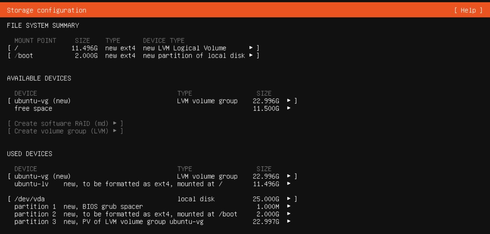
 
#### Variant without LVM (for a simpler layout that you do not plan to change later)
 
If on the first screen we **uncheck** the option *Set up this disk as an LVM group*, the installer will propose a simpler layout without logical volumes:
 
| Mount Point | Size | Type | Device |
|---|---|---|---|
| `/` | approx. 25 GB (entire disk) | ext4 | regular disk partition (partition 2) |
| – | 1 MB | BIOS grub spacer | partition 1 |
 
Differences compared to the LVM variant:
 
- the entire available disk is allocated to `/` – there is no free space in the volume group (in *AVAILABLE DEVICES* there appears *No available devices*),
- there is no separate `/boot` partition or `ubuntu-vg` group,
- the layout is simpler, but later changes in size, combining disks into shared space, and creating snapshots are less convenient than with LVM.
> **Note:** on computers with UEFI (not classic BIOS as in the screenshot), the installer will additionally add a small EFI partition (`/boot/efi`).
 
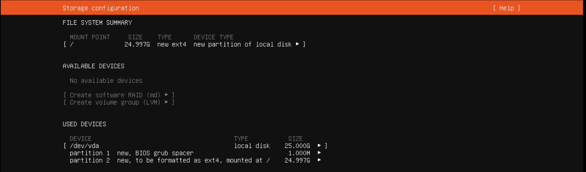

#### Not sure what to choose? 
I recommend starting with the LVM variant and immediately allocating 100% of free space to `/`. To do this, we press space at the `ubuntu-lv` position, select `Edit`, enter the maximum value in the `Size` field, and then select `Save`.

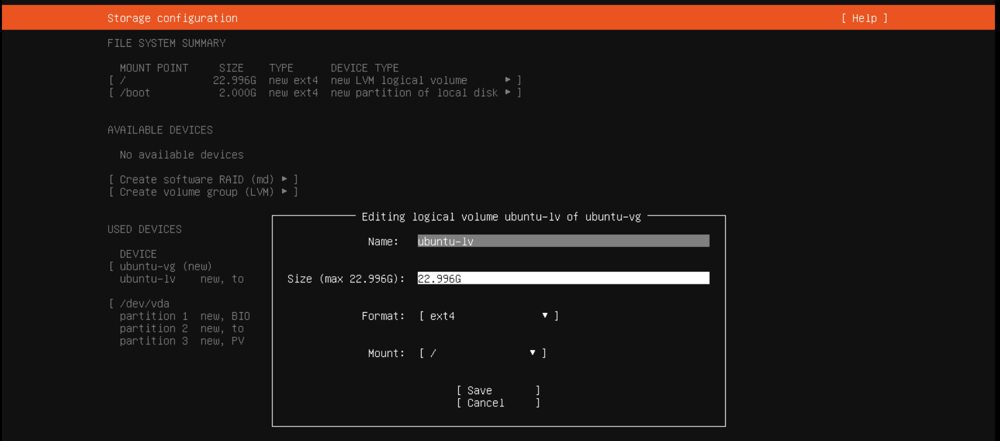


---

### 9. User Profile

We complete the data:

| Field | Description | Example |
|---|---|---|
| **Your name** | First name / username | `bk` |
| **Your server's name** | Server name (hostname) visible on the network | `bk-server` |
| **Pick a username** | User login | `bk` |

A password is also needed to execute commands via `sudo`, even when we later log in via SSH.

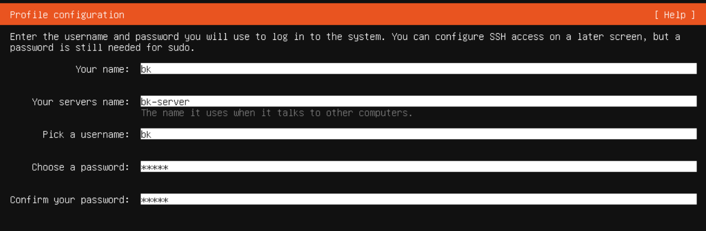

---

### 10. Ubuntu Pro

We select **Skip for now** – we do not activate Ubuntu Pro. If needed, it can be done later with the `pro attach` command.

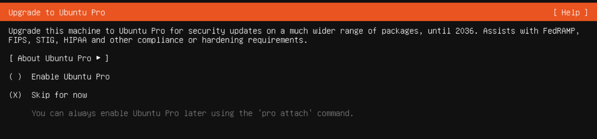

---

### 11. SSH Configuration

We check **Install OpenSSH server** so that we can connect to the server remotely.

- *Allow password authentication over SSH* – remains checked (password login).
- *Import SSH key* – optional; if we do not import a key, we leave it unchanged (*No authorized key*).

Connection from another computer:

```bash
ssh bk@<server-ip-address>
```

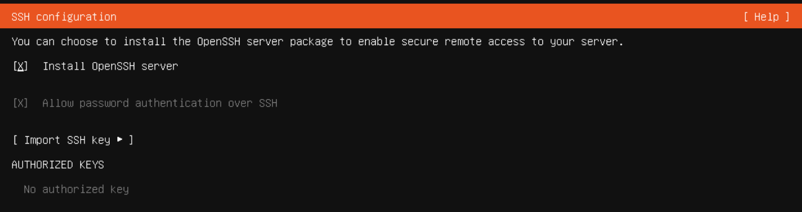

---

### 12. Additional Packages (Featured Server Snaps)

We do not check any package – we install only the base system. We proceed with the **Done** button. Everything that is needed can be installed later.

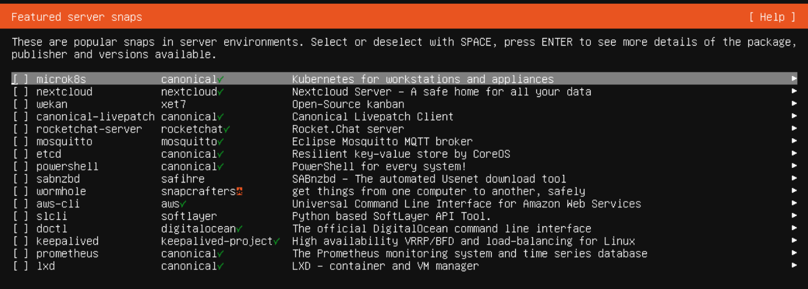

---

### 13. Completion

After confirming the last screen, the actual installation will begin. When it is finished (the **Reboot Now** button appears):

1. We select **Reboot Now**.
2. After the message appears, we remove the installation media and press Enter.
3. After restart, we log in with the created user.

The server's IP address can be checked with the command:

```bash
ip a
```

---

### 14. Updates

Finally, it's worth updating the system before proceeding with installing additional programs.
```
sudo apt update
sudo apt upgrade -y
```
