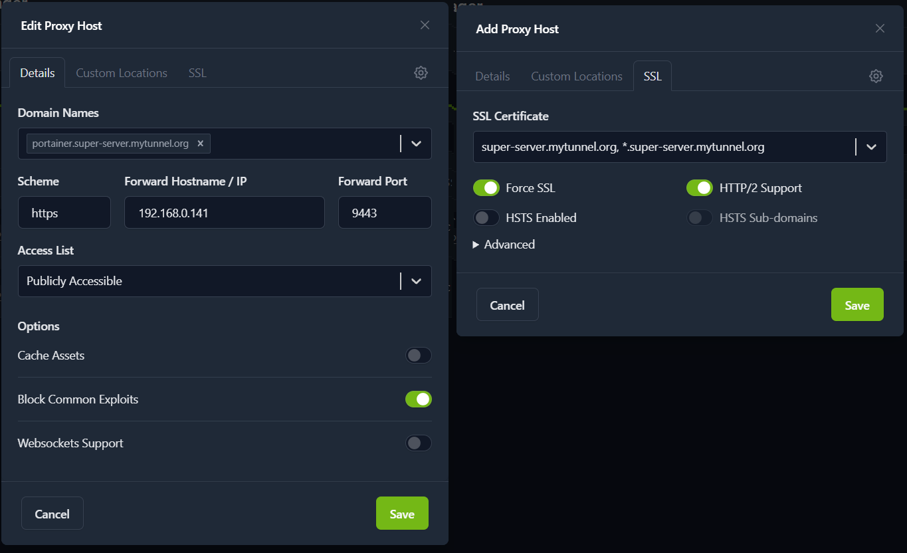

### Portainer [ [docs](https://docs.portainer.io/start/install/server/docker/linux) ]

- create directories:
  ```bash
  cd ~/docker/setup
  mkdir -p portainer/data
  touch portainer/portainer.compose.yml
  nano portainer/portainer.compose.yml
  ```

- paste the content of [portainer.compose.yml](../config/templates/portainer.compose.yml) and save `ctrl+o --> enter --> ctrl+x`.

- open `.env` file and add portainer section:
  ```bash
  nano .env
  ```
  ```
  # Portainer
  PORTAINER_HTTPS_PORT=9443
  ```

- save file `ctrl+o --> enter --> ctrl+x`

- run the container:
  ```bash
  sudo docker compose --file portainer/portainer.compose.yml --env-file .env up
  ```

- look at logs to see whether the container started and hit `d` to detach if there are no issues.

- in case of issues you can detach and stop the container:
  ```bash
  sudo docker compose --file portainer/portainer.compose.yml --env-file .env down
  ```

- before going to web interface you'll need setup_token for creating the first user. Run below command to reveal it:
  ```bash
  sudo docker logs portainer
  ```

- in a web browser go to address: `192.168.x.x:9443` (your server) and create the first user.

- if you have Nginx Proxy Manager set up you can set a proxy host for portainer as shown
  

