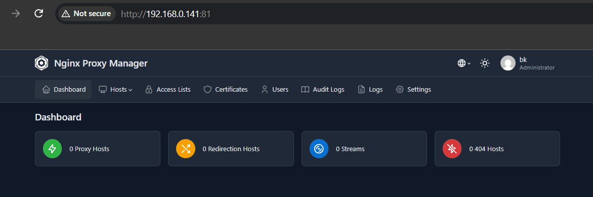
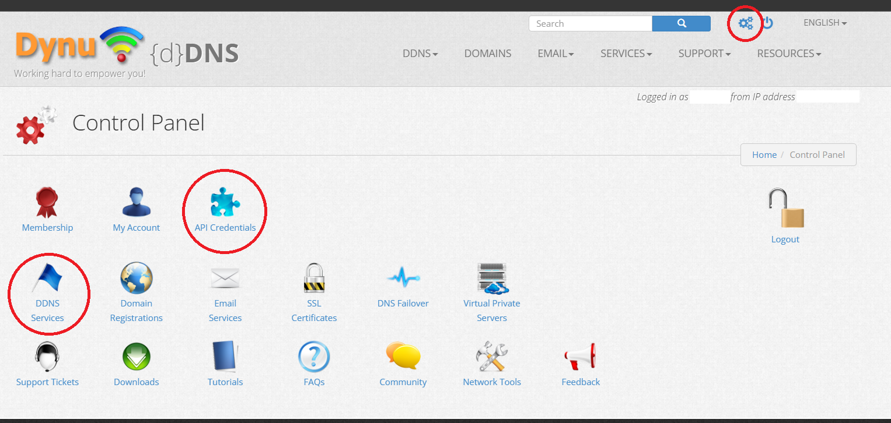
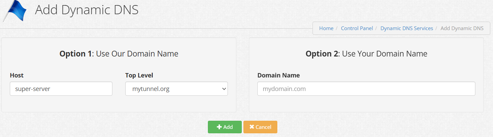
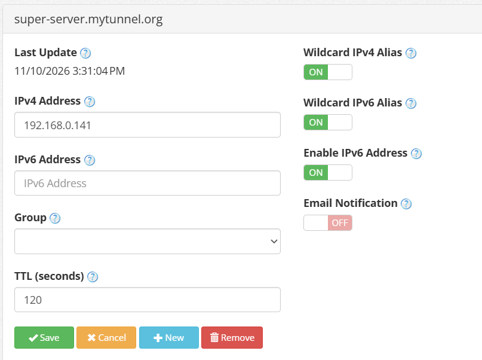
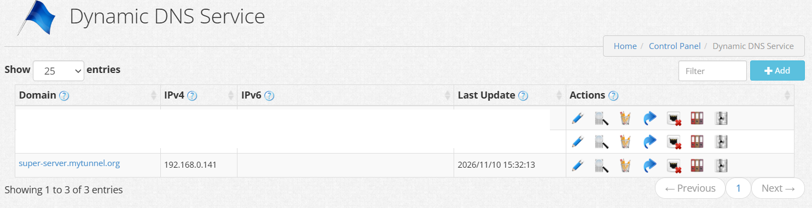
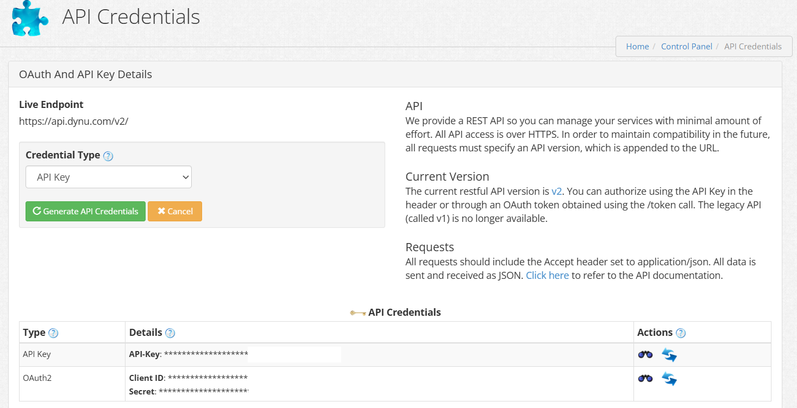
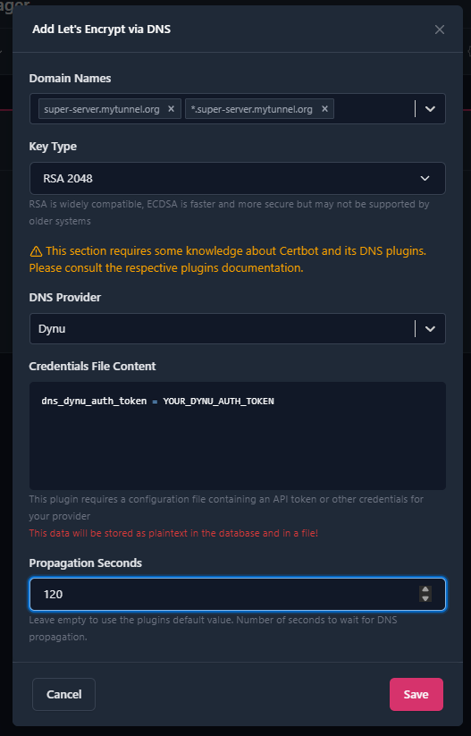
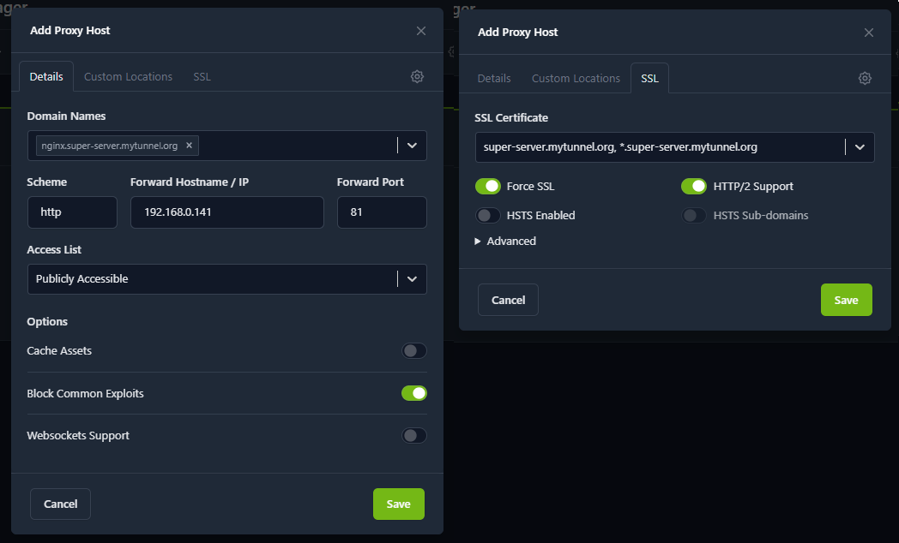
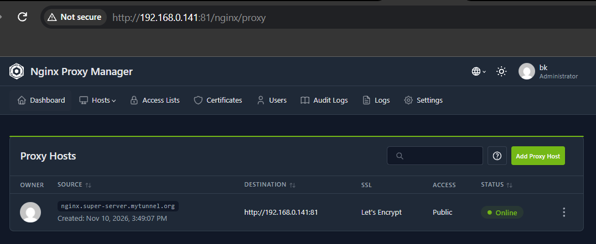
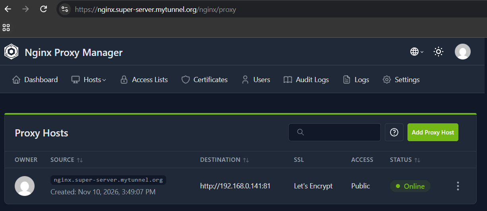

### Nginx Proxy Manager [ [docs](https://github.com/NginxProxyManager/nginx-proxy-manager) ]

- create directories:
  ```bash
  cd ~/docker/setup
  mkdir -p nginx-pm/data nginx-pm/letsencrypt
  touch nginx-pm/nginx-pm.compose.yml
  nano nginx-pm/nginx-pm.compose.yml
  ```

- paste the content of [nginx-pm.compose.yml](./setup/templates/nginx-pm.compose.yml) and save `ctrl+o --> enter --> ctrl+x`.

- open `.env` file and add nginx section:
  ```bash
  nano .env
  ```
  ```
  # Nginx Proxy Manager
  NGINX_PM_VERSION=latest
  NGINX_HTTP_PORT=80
  NGINX_ADMIN_PORT=81
  NGINX_HTTPS_PORT=443
  ```

- save file `ctrl+o --> enter --> ctrl+x`

- run the container:
  ```bash
  sudo docker compose --file nginx-pm/nginx-pm.compose.yml --env-file .env up
  ```

- look at logs to see whether the container started and hit `d` to detach if there are no issues

- in case of issues you can detach and stop the container:
  ```bash
  sudo docker compose --file nginx-pm/nginx-pm.compose.yml --env-file .env down
  ```

- in a web browser go to address: `192.168.x.x:81` (your server admin port) and fill admin user account information to create it
- you should see home panel

- click *Certificates* and leave the panel there for now. We need to set up free DNS first

#### > Free DNS setup

To create a certificate, you need a domain and a DNS service. One of many free options is Dynu ([Dynu website](https://www.dynu.com/))
- create an account and log in
- on the home screen, click the settings gear icon in the top right corner. You should see this screen:

  

- open *DDNS Services* and click *+Add* on the right side, then select an available domain name and its extension:

   

- click *+Add*. In the next step, enter your server's local IP address in the *IP* field, then click *Save*:

  

- after returning to the *DDNS Services* screen, you should see the created address:

  

- return to the services screen, click the settings gear icon in the corner, and select *API Credentials*
- if you don't have an API key yet, generate it with the *Generate API Credentials* button, then reveal the *API Key* value and copy it

  

#### > Request Certificate

- go back to the certificates page in Nginx Proxy Manager, click *Add certificate*, and select *Let's Encrypt via DNS*

- enter your domain address, select Dynu as the provider, and paste the API key you copied earlier
- click *Save* and wait for the result. This may take over a minute:

  

- after the operation completes, you should see the new certificate opn the list
- if you encounter any issues, see the section at the end of this document

#### > Creating a proxy host

- with a certificate in place, you can now configure the redirect from your domain to your server's IP address and the appropriate port
- in Nginx Proxy Manager, go to *Dashboard*, then to *Proxy Hosts*
- click *Add proxy host* and fill in the fields as shown below.
  **important note:** instead of **192.168.0.141** you can also provide container name with internal port, i.e. **nginx-pm** (container name from compose file) and **81** (in-container port) 

  


- now you can test the proxy. Below is a screenshot of the website accessed directly by IP address (note the *Not secure* warning):

  

- when you enter the newly created proxy address, the website looks like this: the connection is secure, and the IP address is not visible in the address bar

  

#### > Notes

##### Domain availability on the internet

These proxy redirects work only on your local network, so domains are not accessible from outside. If someone enters such an address on a computer connected to a different network, they will be redirected to `192.168.0.141` on their own network and will most likely see an error saying that the page does not exist. In this configuration, services are not exposed outside the local network or to the internet.

##### Proxy configuration for containers

For each new container with a web interface, you can configure a proxy host. This allows you to access its interface at a domain address, for example *my-container.super-server.mytunnel.org*.

##### Troubleshooting

The following issues may occur when generating a certificate:
- **No certificate:** make sure there are no extra spaces in the field with the key `dns_dynu_auth_token=YOUR_DYNU_AUTH_TOKEN`, especially around the `=` sign
- **Internal Server Error:** you have likely reached the certificate request limit for the selected domain extension (e.g., `mytunnel.org`). Try selecting a different domain
- **Timeout:** the wait time for a response has expired or an error occurred. Try again and set a value greater than 120 in the last field
- **Endless loading:** check if the certificate has already appeared in the background of the window. Sometimes the window freezes and doesn't close, even though the operation completed successfully
