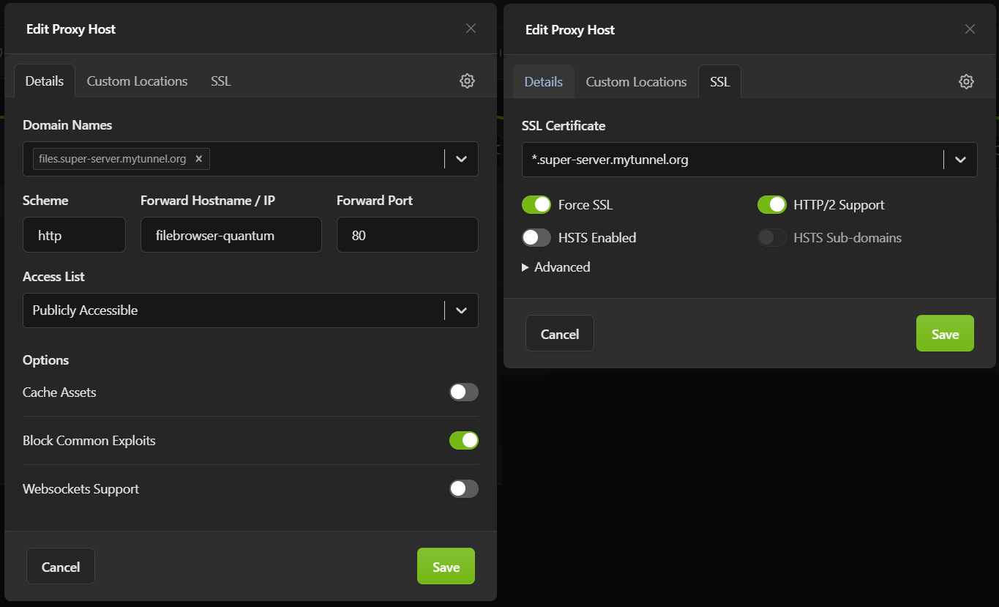

#### Filebrowser [ [docs](https://filebrowserquantum.com/en/) ]

- create directories:
  ```bash
  cd ~/docker/setup
  mkdir -p filebrowser/data
  touch filebrowser/filebrowser.compose.yml
  nano filebrowser/filebrowser.compose.yml
  ```

- paste the content of [filebrowser.compose.yml](./setup/templates/filebrowser.compose.yml) and save `ctrl+o --> enter --> ctrl+x`.
- create directory for default USER_X:
  ```bash 
  mkdir -p ~/docker/data/users/USER_X
  ```
- open `.env` file and paste filebrowser section (**put there your values!**):
  ```bash
  nano .env
  ```
  ```
  # FileBrowser
  FILEBROWSER_VERSION=stable
  FILEBROWSER_HTTP_PORT=7000
  FILEBROWSER_ADMIN_PASSWORD=USER_X_FB_ADMIN_PASS
  ```
- save file `ctrl+o --> enter --> ctrl+x`
- create and open `config.yaml` file:
  ```bash
  touch filebrowser/data/config.yaml
  nano filebrowser/data/config.yaml
  ```
- paste the content of [filebrowser.config.yml](./setup/templates/filebrowser.config.yml) and save `ctrl+o --> enter --> ctrl+x`. 
- run the container:
  ```bash
  sudo docker compose --file filebrowser/filebrowser.compose.yml --env-file .env up
  ```
- look at logs to see whether the container started and hit `d` to detach if there are no issues
- in case of issues you can detach and stop the container
  ```bash
  sudo docker compose --file filebrowser/filebrowser.compose.yml --env-file .env down
  ```
- create user for non-admin:
  ```bash
  sudo docker exec -it filebrowser-quantum sh
  ```
  inside container shell:
  ```bash
  ./filebrowser user set USER_X --password
  --> enter password for the user
  exit
  ```
- in a web browser go to address: `192.168.x.x:FB_PORT_FROM_ENV` (your server) and log in as admin. 
  - go to settings (cogwheel icon)
  - go to user management
  - click pencil icon in USER_X row
  - under sources click *Home* dropdown list and enable all options to add write rights
  - save and log out
  - alternatively you can look throgh other settings you may want to change

- if you have Nginx Proxy Manager set up you can set a proxy host for filebrowser as shown
  