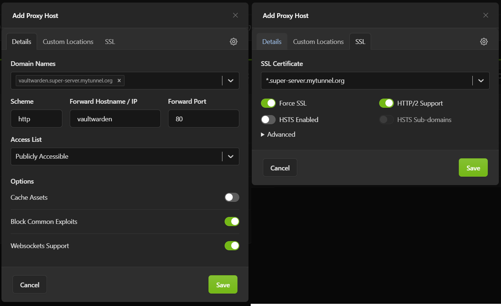

### Vaultwarden [ [docs](https://github.com/dani-garcia/vaultwarden) ]

- create directories:
  ```bash
  cd ~/docker/setup
  mkdir -p vaultwarden/data
  touch vaultwarden/compose.vaultwarden.yml
  nano vaultwarden/compose.vaultwarden.yml
  ```

- paste the content of [compose.vaultwarden.yml](./compose-files/compose.vaultwarden.yml) and save `ctrl+o --> enter --> ctrl+x`.

- generate admin token hash. First, install argon2 package:
  ```bash
  sudo apt install argon2
  ```

- generate the admin password hash (replace `USER_X_ADMIN_PASSWORD` with your desired admin password):
  ```bash
  echo -n 'USER_X_ADMIN_PASSWORD' | argon2 "$(openssl rand -base64 32)" -e -id -k 65540 -t 3 -p 4
  ```

- copy the output hash. You will need it for the `.env` file.

- open `.env` file and add vaultwarden section (**put there your values!**):
  ```bash
  nano .env
  ```
  ```
  # Vaultwarden
  VAULTWARDEN_VERSION=latest
  VAULTWARDEN_HTTP_PORT=7001
  VAULTWARDEN_SIGNUPS_ALLOWED=true
  VAULTWARDEN_ADMIN_TOKEN='$argon2id$v=19$m=65540,t=3,p=4$<YOUR_HASH_HERE>'
  ```

- save file `ctrl+o --> enter --> ctrl+x`

- run the container:
  ```bash
  sudo docker compose --file vaultwarden/compose.vaultwarden.yml --env-file .env up
  ```

- look at logs to see whether the container started and hit `d` to detach if there are no issues

- in case of issues you can detach and stop the container:
  ```bash
  sudo docker compose --file vaultwarden/compose.vaultwarden.yml --env-file .env down
  ```

- in a web browser go to address: `192.168.x.x:7001` (your server) and you should see the Vaultwarden login screen

- click *Create account* and follow the account creation wizard, entering your email address and master password

- if you have Nginx Proxy Manager set up you can set a proxy host for vaultwarden like shown:
  

#### > Admin Panel

- the admin panel is accessible at `vaultwarden.yourdomain.com/admin` (or directly at `192.168.x.x:7001/admin`)

- to log in to the admin panel, use the admin password that you hashed with argon2 in the earlier step (not your account master password)

- the admin panel allows advanced server configuration, but for personal use you typically won't need it

#### > Disable Signups

If you want to disable creating new accounts after setting up your own account, perform these steps:

- edit the `.env` file:
  ```bash
  cd ~/docker/setup
  nano .env
  ```

- set `VAULTWARDEN_SIGNUPS_ALLOWED: false`

- restart the container:
  ```bash
  sudo docker compose --file compose.vaultwarden.yml --env-file ../.env down
  sudo docker compose --file compose.vaultwarden.yml --env-file ../.env up
  ```

#### > Bitwarden Browser Extension

To use your Vaultwarden server, install the official Bitwarden extension for your browser:

- add the official Bitwarden extension from your browser's extension store

- once installed, click the extension icon and select *self-hosted* option at the bottom

- enter your Vaultwarden server address (e.g., `https://vaultwarden.yourdomain.com`)

- log in with your account email and master password

- from now on, the extension will suggest saving passwords and auto-fill previously saved passwords in your browser
